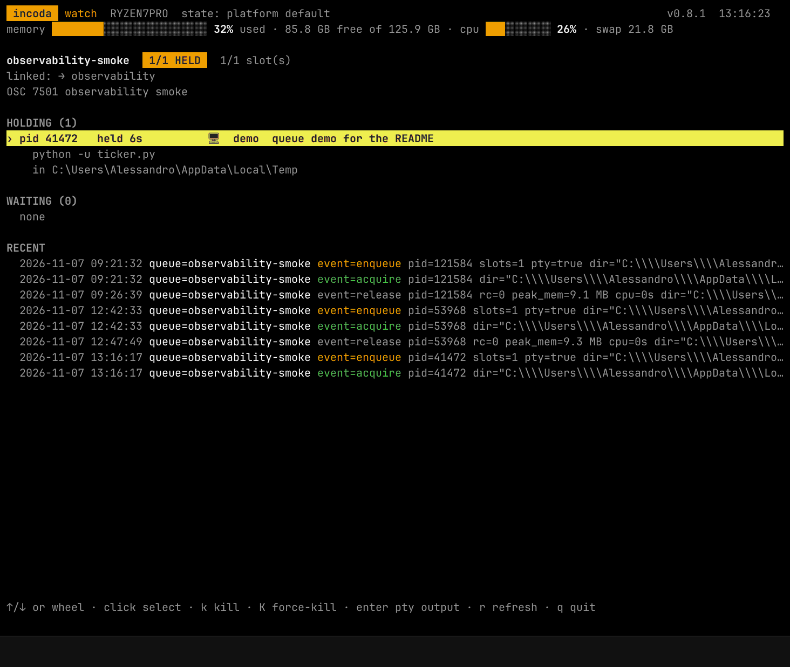

# incoda

### One heavy job at a time. A keyed, machine-local job lane for builds, tests and AI-agent fleets.

`incoda` serialises heavy processes through named queues on one machine. Prefix
any command and it either runs immediately or waits its turn, FIFO by arrival.
When a holder dies, the kernel frees the lane: no stale locks, no takeover
logic, no `--force` in the common case. One static Go binary, no dependencies.


*(Recorded with [`docs/img/demo.tape`](docs/img/demo.tape); re-record it with [vhs](https://github.com/charmbracelet/vhs).)*

```bash
incoda run --queue builds --reason "zig build (LLVM)" -- zig build -Denable-llvm
incoda run --queue builds --reason "dotnet test suite" -- dotnet test
incoda status --queue builds
```

## Why

Load a machine with enough heavy jobs and it settles the argument for you. On a
memory-constrained workstation, two concurrent memory-hungry builds can push
the kernel into swap exhaustion and a watchdog panic, and there is no warning:
macOS reports `memoryPressure` as FALSE right up until the machine dies. The
fix is not more RAM. It is making the collision impossible: heavy jobs go
through one lane, so they cannot overlap.

The same shape of problem shows up wherever two jobs fight over a resource:
GUI test runs that need the desktop to itself, builds that share one cache
directory, anything driving a device. `incoda` is for anything that needs the
machine, or some part of it, to be quiet.

## What people use it for

- **AI agent fleets.** You are orchestrating a dozen agent sessions in parallel
  and they all want to build, test and lint at once. Give each session the same
  `--queue` key and the heavy work serialises instead of colliding. Works
  across git worktrees: nothing is keyed to a working directory.
- **GUI and E2E test runs.** Two of them at once fight over focus, the
  foreground window and synthesized input, and both fail in ways that look like
  product bugs. A `gui-tests` queue gives each run the desktop to itself.
- **`--slots N` for resources that are not exclusive.** Two CPU-heavy linters
  at a time, no more. Put the number in the queue's config; a run may not
  disagree with it.
- **Shared workstations and self-hosted runners.** One Mac mini serving several
  people, agents or CI jobs: same key, orderly queue, full visibility of who is
  holding it from where.
- **Agent compliance by convention.** Ships with a rule block
  ([`AGENT-RULE.md`](AGENT-RULE.md)) for `CLAUDE.md` / `AGENTS.md`, so your
  agents route heavy commands through the lane without being told each time.

## How it works

**Keys.** A queue is a name. `--queue builds` and `--queue gui-tests` never
block each other. There is no default key: an unkeyed `run` is refused, because
two unrelated projects silently sharing one lane is exactly the failure this
tool prevents.

**Pools.** A key is either a project lane or a machine-wide pool. The four
pools are registered per machine in `machine.json` (`builds`,
`computer-use`, `tests`, `vm`); each guards one resource and is shared by every
project on the box. A project lane is linked to the pools its jobs actually
use, and a run takes its project lanes first and then the linked pools, one at
a time in sorted order. Until the link is set the lane is **unlinked** and
every run on it is refused with the command that makes the link, because
guessing which pool a job belongs to is the user's call and not the tool's:

```bash
incoda config my-app-build --pool builds   # link it; --replace / --add-pool / --remove-pool / --unlink
incoda run --queue my-app-build -- zig build   # now runs, holding my-app-build and builds
incoda run --queue my-app-build --pool builds -- dotnet test   # this run only takes that pool
```

A new pool is added with `incoda pool add NAME --slots N`, which leaves every
existing pool alone. `doctor --rebuild-registry` is for a lost registry only: it
rewrites `machine.json` naming exactly the pools you list.

`--quiet-machine` makes every run on a lane hold its pools exclusively while
it waits for the rest, which is what a measurement job needs: it wants the
pools drained, not merely its own slot.

**Slots.** Each queue has a slot count, default 1: plain mutual exclusion.
`incoda config builds --slots 2` lets two holders run at once, and the config
is the width, in both directions: every `run` on that key takes the
configured number, a run that passes a disagreeing `--slots` is refused
rather than silently clamped (one stray `--slots 1` used to drag a five-slot
queue down to one for everyone), and a ticket left by an older `incoda` can
neither narrow the queue nor widen it. `--exclusive` asks for the queue
alone: while that run is live the count is 1, whatever the queue says, which
is what a timing-sensitive test needs. `--queue a,b` holds several queues
for one command, taken in sorted order so two such runs can never deadlock
each other.

**Config, not convention.** A queue can carry a description, require a
`--reason` on every run, or be closed with a message that names its
replacements. A closed key refuses every run, which is how a retired lane
stops silently serialising work nobody meant to put there.

**FIFO, really.** Ticket filenames encode arrival order, every participant
derives the order from the same directory listing, and a later arrival cannot
overtake an earlier one. Waiters poll instead of waiting on a signal, so
nothing can go stale; the cost is up to one poll interval (500 ms default) of
handoff latency.

**The kernel holds the lock.** Every participant holds an OS-level exclusive
lock on its ticket file for its whole lifetime: `flock` on Unix,
`LockFileEx` on Windows. The kernel releases it when the process ends for any
reason, including `SIGKILL` and power loss. Stale tickets are reaped by trying
to lock them; there is no pid file to lie.

**Machine-local and per-user, never per-directory.** The real callers are
several agent sessions, each in its own git worktree. `incoda run --queue
builds` contends for the same lane from any folder, worktree or drive letter.
State lives in one place per user (`%LOCALAPPDATA%\incoda` on Windows,
`~/Library/Application Support/incoda` on macOS, `$XDG_STATE_HOME/incoda` on
Linux) and nothing is ever resolved from the working directory.

## Commands

| Command | What it does |
|---|---|
| `incoda run --queue KEY[,KEY...] [--pool P,P] [--slots N] [--exclusive] [--max-cpu PCT] [--idle-for DUR] [--max-run DUR] [--stall DUR] [--wait DUR] [--reason TEXT] [--owner WHO] [--pty=false] -- <cmd...>` | Acquire a slot on every key named, run the command, release on every exit path. `--pool` takes a subset of the key's linked pools for this run only. `--wait` takes a Go duration (`30m`) or bare seconds (`1800`); `0` fails fast, negative waits forever, default `30m`, and one budget covers the whole list. `--owner` (or `INCODA_OWNER`) names the session or worktree that queued the job. `--pty`/`--pty=false` choose console or pipes per job; on Windows the default is a pseudo-console (see [PTY jobs](#pty-jobs)). A gated run starts only after whole-machine CPU% stays below `PCT` for `DUR` (advisory, shares `--wait`, exit `121` on expiry; runs without the flags bypass the gate). `--max-run DUR` kills the job once it has held the lane for `DUR`, and `--stall DUR` kills it when its whole process tree has used no CPU time for `DUR` (see [Run limits](#run-limits)). |
| `incoda config KEY [--slots N] [--description TEXT] [--require-reason] [--close MSG \| --open] [--pool P,P [--replace] \| --add-pool P,P \| --remove-pool P,P \| --unlink] [--quiet-machine[=false]] [--max-run DUR] [--stall DUR] [--wait DUR]` | Show or set a queue's standing configuration: default slots, a description for `status` and `watch`, whether a run must carry `--reason`, a closing message that refuses every run, the link to the machine-wide pools the key's jobs take, and the default `--max-run` and `--stall` its runs take (`0` clears one). |
| `incoda status [--queue KEY] [--all] [--json]` | Holders and waiters in arrival order, with pid, elapsed time, command, working directory and reason. A `🖥️` marks every pty-mode job; a job's own OSC 7501 status badges that mark with its state as a glyph and its progress (`🖥️ 🔄 40%`), its message ending the line. `--json` is a stable, versioned schema for scripts. |
| `incoda watch [--queue KEY] [--interval 2s] [--once \| --plain]` | The live screen. With no key, an overview of every queue: state, holders, waiters, oldest wait, what each guards, and the memory gauge; click or enter opens a queue, `k` kills the selected job after asking for a reason, `K` forces. Pty jobs carry a `🖥️`; `enter` on one streams its captured output live in a fixed window (scroll with the arrows, PgUp/PgDn and Home; End follows the tail), ends by itself when the job does and shows the exit code it recorded — viewing is open to everyone. Mouse: click to select, double-click to open, wheel to move. `--queue` opens one queue directly. On a pipe, or with `--once` or `--plain`, it repaints the plain `status` text instead. |
| `incoda queues` | Every queue with state on this machine, and whether it is busy. |
| `incoda kill --queue KEY --pid N --reason TEXT [--wait 5s] [--force]` | Ask a holder or waiter to stop. Its own `incoda` notices within a poll, prints who killed it and why on its stderr, takes its job tree down and exits `124`. `--force` terminates a participant that does not answer. |
| `incoda attach --queue KEY --pid N` | Stream a pty job's output live, from its start, read-only, until the job's run process is gone. Viewing is open to everyone; typing at the job is `answer`'s business and stays owner-gated. |
| `incoda answer --queue KEY --pid N --text TEXT [--owner WHO] [--raw] [--wait 10s]` | Type a reply at a pty job that reported itself `blocked` over OSC 7501 (kind `question`, `permission` or `auth`): the text is delivered to the job's console input, echo-free, and a carriage return completes it unless `--raw`. Only the job's own owner may answer, and only while the job's own record says blocked — the run enforces both against the live ticket and refuses with a named reason. Delivered exits `0`, a refusal `120`, an answer no run took in time `126`. The job's log never shows what was typed. |
| `incoda force-release --queue KEY [--live]` | Delete a queue's tickets. Refuses while live participants exist unless `--live`. You almost never need this. |
| `incoda pool add NAME [--slots N] [--description TEXT] [--wait DUR]` | Register one new machine-wide pool and say what changed. Takes `machine.lock`, writes `machine.json` by temp file and rename, and touches no other pool or lane (the generation counter goes up by one). Refuses a name that is invalid or already a pool (`pool-exists`, exit `120`), and a lane of that name that links pools or has a live job (`kind-busy`). `--slots` and `--description` set the pool's `config.json` first, so a crash in between leaves a plain lane and the same command can be rerun. Logs `event=pool-add` to the pool's `lane.log`. |
| `incoda doctor [--rebuild-registry POOL,POOL... [--wait DUR]]` | State directory, `INCODA_DIR` warning, writability, and a real locking probe that fails loudly on filesystems that do not enforce locks. `--rebuild-registry` rewrites the machine registry after one was lost or damaged, holding every lane still while it checks. |

`run` passes the child's own exit code through unchanged. Lane-level failures
use a separate band, documented and stable: `120` usage, `121` wait elapsed
while still queued or waiting for idle,
`122` state unusable, `123` spawn failure, `124` killed through the lane,
`125` a kill that was not acknowledged, `126` an answer no run took in
time, `130` interrupted while queueing, `131` the job was ended by
`--max-run`, `132` the job was ended by `--stall`. The two limit codes sit
above the others so a caller can tell "stopped by the limit" from "failed"
(the child's own code) and from "killed by a person" (`124`); as with every
code above 124, a child that exits with the same number by itself cannot be
told apart, so a script that must be sure reads the `limit=` field on the
release line in `lane.log`.

### Run limits

A job that wedges keeps its slot until someone notices, and everything queued
behind it waits. Two limits release it:

```
incoda run --queue builds --max-run 90m --stall 20m -- zig build
incoda config builds --max-run 90m --stall 20m   # the lane's default for every run
```

- `--max-run DUR` kills the job once the command has been running for `DUR`.
  The clock starts when the command starts, so time spent queued, or waiting
  for an idle machine under `--max-cpu`, is not counted.
- `--stall DUR` kills the job when its process tree has used no CPU time for
  `DUR`; any CPU use inside the tree restarts the window. What counts as the
  tree: on Windows, every process that runs in the job, exited ones included
  (the Job Object's accounting); on Linux and macOS, the command, its live
  descendants and the members of its process group, read from the process
  list at each sample, so a process that has exited takes its CPU time with
  it, and one that starts and ends between two samples is not seen.

**What `--stall` cannot see.** CPU used outside the tree is invisible: a build
server or daemon that was already running and does the real work for the job,
or a descendant that detached from the tree. A job in a long wait for disk,
network or input, or one waiting for a person to `incoda answer`, uses no CPU
and reads as idle, so it can be killed. Set `--stall` above the longest such
wait, or `--stall 0` for a job that waits on people. A `--stall` under 30
seconds draws a warning, one under a second is refused, and a bare number is
seconds (`--stall 20` is twenty seconds, not twenty minutes).

`--stall` is armed only after incoda has seen the CPU counter rise: it starts a
short process that spins and requires the reading to move. A counter that never
moves would make every job look idle, so on a platform whose counter fails that
check, or has no reader, the run says so on stderr and in `lane.log`
(`event=limit-unavailable`) and goes on without the limit. The same warning is
given if the reading is lost while the job runs; it never kills on a reading it
could not take. The check costs a fraction of a second per run that uses
`--stall`.

`DUR` is a Go duration (`90m`) or bare seconds (`5400`). A flag given on `run`
beats the lane's default, and `--max-run 0` or `--stall 0` turns the default
off for that run. When a run holds several lanes without a flag, the tightest
non-zero default among them applies. A default that is not a duration (a hand
edit of `config.json`) is reported and ignored; `incoda config KEY --max-run 0`
clears it.

The defaults appear in `status --json` as `max_run` and `stall` in each queue's
`config` object, as Go duration strings (`"1h30m0s"`), and are absent when
unset. A lane that carries a default is stamped with config schema 3, so an
older incoda refuses it (exit `122`, "written by a newer incoda") rather than
running it without the limit; clearing both returns the lane to schema 2.

A limit takes the job down the way `incoda kill` does: the run ends the job
tree (on Unix, the process group and every live descendant, repeated until none
is left; a descendant already adopted by init is out of reach and survives),
prints on stderr which limit fired and why, releases the lane, and exits
`131` for `--max-run` or `132` for `--stall`. The `event=kill` line and the
`event=release` line in `lane.log` both carry `limit=max-run` or
`limit=stall`, so the cost of wedged jobs can be read without the job's output.

A nested `run` on a lane its parent already holds has no ticket of its own:
the lane's defaults belong to the parent, which enforces them against the
whole tree. Only a limit the nested run was given by flag applies, to its own
child and that child's descendants, and it exits with the limit's code, which
the parent sees as the child's ordinary exit status. On Windows a job that
exits with status 0 on its own is never reported as limited, whatever the
timer did at the same instant: the Job Object path is where that is proven. On
Unix a max-run kill landing inside the child's exit window can convert an
exiting child into a signal death and report `131`, a known residual tracked
in #35, next to the stall-counter deferral above.

Output is colored on a terminal and plain everywhere else. The standard
opt-outs work: `--no-color`, or `NO_COLOR` set to any non-empty value, and
color never reaches `--json` or a pipe. `CLICOLOR_FORCE=1` turns it back on
for `| less -R` and its cousins.

Signals are forwarded to the child. On Windows the child runs inside a Job
Object with kill-on-close, so a `SIGKILL` of `incoda` still takes the whole
build tree with it. On Unix the child gets its own process group; a hard kill
of `incoda` can orphan it (see [limits](#known-limits)).

### PTY jobs

On Windows a run starts its job inside a pseudo-console (ConPTY) by default,
and `--pty=false` is the per-job opt-out back to pipes. The job sees a real
TTY, so it may color its output, draw progress bars, or wait on a prompt
where the pipe path would have failed fast; if a job behaves differently
under a TTY, keep that job on `--pty=false`. Bytes are never interpreted on
the way through: escape and OSC sequences reach the output exactly as the
job wrote them. On other systems jobs run on pipes, and an explicit `--pty`
is refused with exit `120`.

Every byte the job writes still reaches the run's own stdout, and is also
teed to one job file per lane the run holds (`jobs/TICKET.out` under each;
`--queue a,b` holds two lanes, so the same bytes land in two files), capped
at 16 MiB with an in-band truncation marker, and the newest 10 files are
kept per lane. A nested run that passes through on a key its parent already
holds has no ticket of its own and writes no job file: its bytes reach its
stdout only, and there is nothing to attach to.

ConPTY wraps the stream itself: the capture carries conhost's own prologue
and epilogue (mode-set sequences such as `?9001h` and `?1004h`, a screen
clear, and a title sequence naming the job executable's path) around
whatever the job wrote. They pass through un-mangled like every other byte,
so an attach opens with a screen clear and a title it did not write; that
is conhost, not the job.

`incoda attach --queue KEY --pid N` streams that file live from the start:
useful when the run belongs to one terminal and a second one wants to watch.
The same stream is built into `incoda watch`: pty jobs are marked `🖥️`, and
pressing enter on one shows the capture inside the watch screen, open to
everyone who can see the queue. The capture is a window of fixed height:
each line is clipped to the width, `↑`/`↓` (or `k`/`j`), `PgUp`/`PgDn` and
`Home` read back through the newest 2,000 lines, and `End` follows the tail
again; new output does not slide a scrolled window.

The run records the code it is about to exit with beside the capture
(`jobs/TICKET.exit`, swept with its file) on its way out, before the tickets
are released: the job's own code, or the named failure that ended it (`124`
for a kill, `131`/`132` for a limit). Both `attach` and the watch capture
give the sidecar a moment and then say how the job ended (`job ended; exit
code 3`); a run from before the sidecar existed simply ends without a code.



Attach is read-only and open to everyone, and ends by itself when the job's
run process is gone. Typing at the job is a different door (`incoda answer`),
and only the owner's key opens it. What it prints is the raw captured stream, so attach only to jobs you
know: the bytes are whatever the job wrote, and a job you did not start can
write anything a terminal will render. Kill semantics are unchanged: the job
sits in the same Job Object, and the pseudo-console dies with the run on a
kill, a force-kill and process death.

**Nested runs on a held key pass through.** `run` exports `INCODA_HELD` to
its child, listing the keys it holds. A nested `incoda run` on one of those
keys runs at once inside the parent's lane instead of queueing behind it,
which is what lets a build recipe take its own lane while an agent wraps the
whole recipe in `run` from outside. A nested run on a *different* key queues
as usual.

**Every job leaves its cost in `lane.log`.** The release line records the
peak memory and CPU time of the job tree (`peak_mem=3.2 GB cpu=4m12s`), from
the Job Object on Windows and from `rusage` on Unix, and a dead holder's
ticket is logged as `reaped` when the next scan deletes it. The point is to
size a queue from evidence: whether `--slots 2` fits is a question this log
can answer.

**Every lifecycle line carries where and why.** Enqueue, acquire and release
each append `dir=` (the directory the run was launched from, quoted when it
contains a space), plus `reason=` and `owner=` when set (`%q`-quoted, so free
text with spaces survives); the release line adds `dur=`, the wall time from
enqueue to release, wait included. The log is the machine history of what ran
where: after the fact it can answer "what was building in this directory last
week" and "whose job pinned the lane for 33 minutes", questions the ticket
answers only while it lives. The fields are additive per line, so a log
mixing old and new entries parses alike.

## The watch screen

`incoda watch` on a terminal is an overview of the machine: one row per
queue with its state (`FREE`, `1/2 HELD`, `EXCLUSIVE`, `CLOSED`), who holds
it, how many wait and for how long, and the description from its config;
above it the memory gauge, below it the selected queue's holders. Enter
opens a queue: holders and waiters with pid, owner, reason, command and
directory, then the recent events. `k` on a row asks for a reason and kills
the job through the lane, the same request `incoda kill` leaves; `K` forces
a participant that does not answer. Every kill is logged with who and why,
and the killed job's owner reads the reason on their own stderr.

It is built on [Bubble Tea](https://github.com/charmbracelet/bubbletea),
adapts to light and dark terminals, honours `NO_COLOR`, and supports the
mouse: click to select a row, double-click a queue to open it, scroll wheel
to move selection.

### OSC 7501 status in watch

Programs that report what they are doing over the OSC 7501 program-status
protocol (`ESC ] 7501 ; state=working:id=build:progress=40:msg=<base64> BEL`)
show it in `watch` and plain `status` beside the job's `🖥️` mark: the state
as a glyph (🔄 working, ✅ done, ❌ error, 🛑 blocked, 💤 idle) with its
progress beside it when the job reported one (`🖥️ 🔄 40%`), and the record's
message at the end of the line, colored by state (working in the accent,
done green, error red, blocked yellow, idle dim). Two parts make that
work, and both need `--pty`:

- A job under `incoda run --pty` that asks its terminal whether OSC 7501 is
  supported (`ESC ] 7501 ; ? BEL`) gets the support reply on its console
  input, ending with the terminator its query used (Windows only, like pty
  mode). The reply is delivered with the console's echo off, so it never
  appears in the job's own output whatever mode its console is in — a job
  reading a cooked line (`readline`, `input()`, any `fgets`) gets the reply
  as input, not as echo in its log. A query flood is answered at a bounded
  rate (at most one reply per 100 ms, one reply owed per query up to a small
  bound), so a program that spews queries cannot grow the host without
  limit; what a job never reads is dropped, the silence of a terminal that
  did not answer.
- Every renderer shows the record with the fewest `id` path segments (the
  latest on a tie), so a build's own record speaks for it, not its steps,
  however much output follows it: `watch` (TUI and `--plain` alike) follows
  each held or running pty job's log, reading only the bytes appended since
  its last look, and a one-shot `status` reads the log whole, once. A log
  that stopped recording — it hit its size cap, its writer failed, or the
  run's output was cut — shows no status: the last record in it may be
  stale, and only the runner's own note saying so counts, not a line the
  job printed. The status carries text the job wrote, and like the capture
  view it is open to anyone watching. `status --json` carries the record
  too, as an additive `program_status` object on the pty participant
  (schema stays 1, fields are only ever added), for every caller alike:
  state, kind, progress, app, id, title and msg.

  A job that reports `state=blocked` with a kind (`question`,
  `permission`, `auth`) can be answered: `incoda answer --queue KEY --pid
  N --text TEXT` types the owner's reply at the job's console input —
  echo-free, never reaching the job's log — which is the loop an agent
  driving the queue closes with `status --json` and a shell, and a human
  closes from anywhere the lane is visible.

A chatty reporter cannot flood the lane with reports either: on a pty, one
id's reports pass the drain at most once per 200 ms, and a report arriving
inside that window replaces the one waiting in it (a later report for an id
always supersedes an earlier one), so the newest is what goes out when the
window closes and the run's stdout and every capture stay readable however
many processes report at once. Past 64 distinct ids reporting in one run the
extra ids share a single window between them, so the stream stays bounded
whatever the crowd. Everything else in the stream, and a report paced slower
than the window, passes through unchanged.

In the plain text renderer the accent family has only ANSI yellow, so
`working` is yellow there and amber in the TUI — the same hue, two palettes.

A job on plain pipes emits nothing, so it has no status; that is by design.
A job with no records shows the line it always did.

## Install

macOS (Homebrew):

```bash
brew install deblasis/tap/incoda
```

Windows (Scoop):

```powershell
scoop bucket add deblasis https://github.com/deblasis/scoop-bucket
scoop install deblasis/incoda
```

macOS and Linux (install script):

```bash
curl -fsSL https://raw.githubusercontent.com/deblasis/incoda/main/install.sh | sh
```

Windows (PowerShell install script):

```powershell
irm https://raw.githubusercontent.com/deblasis/incoda/main/install.ps1 | iex
```

The scripts detect OS and architecture, download the matching release asset,
verify its SHA-256 against `SHA256SUMS`, and install to `~/.local/bin` or
`%LOCALAPPDATA%\Programs\incoda`. They refuse to install anything they could
not verify.

Or with Go 1.27+:

```bash
go install github.com/deblasis/incoda@latest
```

Prebuilt binaries for `windows/amd64`, `windows/arm64`, `darwin/arm64`,
`darwin/amd64`, `linux/amd64` and `linux/arm64` are on the
[Releases page](https://github.com/deblasis/incoda/releases).

## Using it with AI agents

The tool works by convention: it binds only what is routed through it. That is
a feature, not a gap, but it means agents have to be told. `AGENT-RULE.md` is a
copy-pasteable rule block for a machine's `~/.claude/CLAUDE.md` or a
repository's `AGENTS.md` that tells every agent session: these command classes
run under the lane, use this key, never bypass it. One paragraph, and a dozen
parallel sessions stop stepping on each other.

## Scope and non-goals

**It serialises. It does not make an oversized single job fit.** If one job
alone drives the machine into swap or an OOM kill, that job is too big for that
machine, and no amount of queueing fixes it. `status` shows a memory readout so
you can see this happening; it is a gauge, not a governor.

**It is advisory. It binds only what is routed through it.** There is no
process-creation interception and there deliberately is none. This works by
convention, which is why `AGENT-RULE.md` exists.

**When the lane makes you wait, that is the tool working.** If the wait is
long, surface it. Do not bypass it.

Not planned: cross-machine coordination (use a real queue or CI for that),
memory limits or cgroups, per-project state directories, distributed locks.

## Known limits

- **Machine-local and per-user.** Two machines, or two OS users on one machine,
  never serialise each other. State must be on a local filesystem; `doctor`
  fails loudly on network mounts that do not enforce locks.
- **Unix process trees survive a hard kill of `incoda`.** The process group
  covers signalled exits; only Windows gets the kill-on-close guarantee.
- **A configured queue refuses a disagreeing `--slots`; an unconfigured one
  settles disagreements on the minimum.** A participant already running is
  never revoked, and that includes the moment an `--exclusive` run arrives: it
  waits for the holders to leave rather than evicting them.
- **A multi-key run holds its first keys while it waits for the rest.** That
  is what makes it deadlock-free, and it also means a job on `a,b` can keep
  `a` busy while it queues on `b`. Use lists for jobs that need everything
  they name, not as a convenience.
- **A nested run can acquire out of order.** A recipe under a held `b` that
  takes `a` inside is the one shape the sorted-order argument does not cover;
  `run` warns about it. Name both keys at the top instead.
- **The memory readout is not uniform.** macOS reports total and swap but not
  available physical memory, because that needs cgo and this binary stays pure
  Go. It says "unavailable" instead of printing a confident zero.
- **Polling costs up to one interval of handoff latency**, and `lane.log`
  grows without bound (slowly; a few lines per run).

## Design

The full rationale (locking protocol, the registry-lock window, ordering
guarantees and their caveats, platform process-tree behaviour, state directory
resolution) is in [`docs/DESIGN.md`](docs/DESIGN.md).

## License

[MIT](LICENSE)
